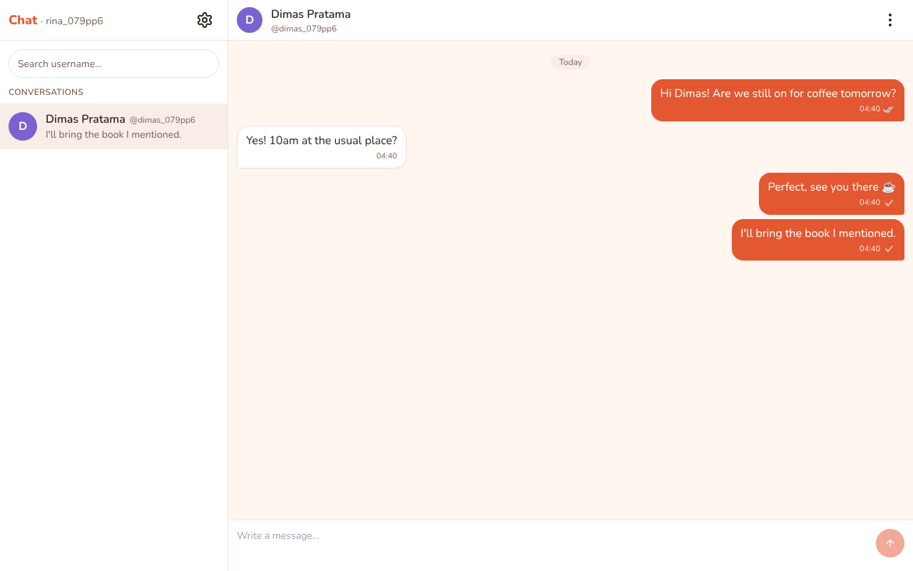
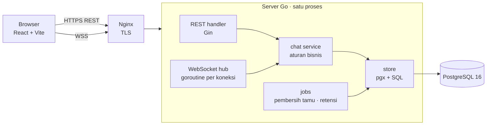
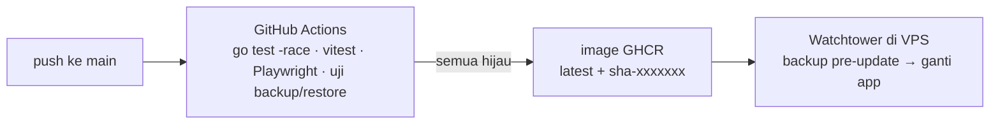

# pmess — Personal Messenger

[](https://github.com/tosrv/pmess/actions/workflows/ci.yml)
[](LICENSE)

[English](README.md) · **Bahasa Indonesia**

Aplikasi chat 1:1 real-time yang dibuat sebagai proyek belajar **sistem real-time dan konkurensi**: backend Go dengan WebSocket dan PostgreSQL, frontend React, serta pipeline CI → registry → deploy otomatis.

**Demo:** <https://chat.rahmattomy.com> — masuk dengan Google, atau lanjut sebagai tamu untuk mengirim pesan ke developer.



## Fitur

- Chat 1:1 real-time lewat WebSocket, dengan status **terkirim ✓ / dibaca ✓✓** dan indikator mengetik
- Cari orang lewat username; display name terpisah dari username
- **Mode tamu**: chat dengan developer tanpa akun (akun dinonaktifkan saat sesi berakhir; percakapan disimpan hingga 1 bulan untuk developer)
- Blokir pengguna, hapus akun sendiri, UI Inggris/Indonesia, tema terang/gelap/ikut sistem
- Pesan tetap aman saat offline dan setelah reconnect; percakapan kedaluwarsa setelah 1 bulan tanpa aktivitas
- Perlindungan penyalahgunaan: Cloudflare Turnstile saat membuat tamu, rate limit per pengguna dan per IP, batas 300 akun

## Arsitektur





Semua aturan bisnis ada di satu paket (`internal/chat`) yang dipakai bersama oleh REST dan WebSocket, jadi aturan seperti "tamu hanya boleh mengirim ke developer" ditulis dan diuji sekali saja.

## Cara menangani konkurensi

Bagian inilah yang menjadi tujuan belajar proyek ini. Setiap jaminan ditegakkan oleh database atau oleh satu jalur kode, dan masing-masing punya test yang bisa dijalankan.

### 1. Urutan pesan rapat dan konsisten per percakapan

Setiap pesan mendapat nomor urut dari counter di baris percakapannya. `UPDATE … RETURNING` mengambil row lock, sehingga pengirim yang bersamaan di percakapan yang sama mengantre, bukan saling balapan:

```sql
UPDATE conversations SET last_seq = last_seq + 1, last_activity_at = now()
WHERE id = $1 RETURNING last_seq
```

`TestConcurrentSend` membuat 50 pengguna mengirim bersamaan — ke 25 percakapan berpasangan dan satu percakapan bersama (1.000 pesan dari 50 pengirim) — dan memastikan nomor urut tiap percakapan tepat `1..N`, tanpa celah dan tanpa duplikat. `BIGSERIAL` global lebih sederhana, tetapi bisa meninggalkan celah dan tidak menjamin urutan commit sama dengan urutan id saat beban tinggi.

### 2. Tanpa duplikat saat klien mengirim ulang

Browser membuat `client_msg_id` (UUID) dan menyimpan pesan yang belum di-ack di outbox. Setelah reconnect, pesan itu dikirim ulang dengan id yang sama. Database menegakkan `UNIQUE (sender_id, client_msg_id)`; kiriman ulang yang menabrak constraint ini di-rollback (sehingga nomor urut tidak terpakai) dan mengembalikan pesan aslinya. `TestResend` mengirim pesan yang sama dari dua goroutine sekaligus dan mengharapkan satu baris saja.

### 3. Menyusul setelah koneksi putus

Klien mengingat `seq` terakhir yang dimilikinya untuk tiap percakapan, lalu memanggil `GET /api/conversations/:id/messages?after_seq=N` setelah reconnect, per halaman sampai tersusul. Digabung dengan poin 2, "tidak ada yang hilang, tidak ada yang dobel" tetap berlaku di jaringan yang tidak stabil.

### 4. Akun ke-300

Batas akun adalah counter satu baris dengan constraint, bukan `COUNT(*)`:

```sql
used int NOT NULL CHECK (used BETWEEN 0 AND 300)
-- saat mendaftar, di transaksi yang sama dengan INSERT:
UPDATE user_slots SET used = used + 1 WHERE id = 1
```

Dua orang yang mendaftar untuk slot terakhir mengantre di row lock; yang kedua melanggar `CHECK` dan mendapat pesan "batas tercapai" yang jelas. `TestSlotRace` melepas dua goroutine bersamaan dan mengharapkan tepat satu yang berhasil.

### 5. Klien lambat tidak memperlambat yang lain

Setiap koneksi WebSocket punya goroutine pembaca, goroutine penulis, dan buffer keluar terbatas (64 frame). Memasukkan pesan ke antrean tidak pernah memblokir: kalau sebuah klien tidak sanggup mengikuti, koneksinya ditutup dan klien itu menyusul lewat poin 3 saat reconnect. Pesan baru diteruskan ke penerima setelah tersimpan (commit).

## Load test

`cmd/loadtest` membuka 50 klien WebSocket di 25 percakapan, masing-masing mengirim 20 pesan, lalu mengukur latensi dari kirim sampai diterima. Tiga run berturut-turut di satu mesin (server, Postgres, dan klien bersama-sama):

| terkirim | diterima | hilang | duplikat | p50 | p95 | maks |
|---:|---:|---:|---:|---:|---:|---:|
| 1000 | 1000 | 0 | 0 | 25–28 ms | 40–46 ms | 56–74 ms |

Alat ini keluar dengan status gagal bila ada kiriman yang gagal, ada pesan yang hilang atau dobel, atau p95 mencapai 1 detik. Cara menjalankannya: [docs/operations.id.md](docs/operations.id.md#verifikasi-spec-10).

## Tech stack

- **Backend:** Go 1.24, Gin, `coder/websocket`, pgx, golang-migrate, PostgreSQL 16
- **Frontend:** React 18, Vite, TypeScript, Tailwind CSS, shadcn/ui, react-i18next
- **Test:** test Go dengan `-race` terhadap Postgres asli (testcontainers), Vitest, Playwright
- **Ops:** Docker, GitHub Actions, GHCR, Watchtower, Nginx, Cloudflare Turnstile

## Menjalankan

```bash
cp .env.example .env    # isi POSTGRES_PASSWORD, DEVELOPER_EMAIL, dan key Google OAuth; untuk localhost set juga
                        # COOKIE_SECURE=false, OAUTH_REDIRECT_URL=http://localhost:8080/api/auth/google/callback,
                        # ALLOWED_ORIGINS=http://localhost:8080
docker compose -f docker-compose.yml -f docker-compose.dev.yml up --build -d
# lalu buka http://localhost:8080
```

Buktikan sendiri jaminan di atas (Docker harus berjalan):

```bash
go test -race ./...
cd web && npm test
```

Mode dev lokal, semua variabel lingkungan, test E2E, deploy, backup, dan restore ada di **[panduan operasional](docs/operations.id.md)**.

## Keamanan & privasi

- Content-Security-Policy yang ketat dan header keamanan lain di setiap respons
- Turnstile saat membuat tamu, diverifikasi di server sebelum rate limit atau slot akun terpakai
- Pihak yang diblokir tidak pernah tahu dirinya diblokir: ia hanya melihat galat umum "tidak ditemukan"
- Sesi tamu berakhir setelah 30 menit tanpa aktivitas (atau logout): akun dinonaktifkan, dan percakapan beserta info kontak yang dibagikan tamu disimpan hingga 1 bulan, lalu dihapus. Tamu yang tidak mengirim pesan dihapus seketika.
- Pesan **tidak** dienkripsi end-to-end — admin server bisa membacanya di database. Hal ini dinyatakan di [kebijakan privasi](https://chat.rahmattomy.com/privacy) aplikasi.

## Dokumen desain

Proyek ini dibangun dengan spec lebih dulu. Design doc dan rencana implementasi tiap fase ada di [`docs/superpowers/`](docs/superpowers/).

## Lisensi

[MIT](LICENSE)
