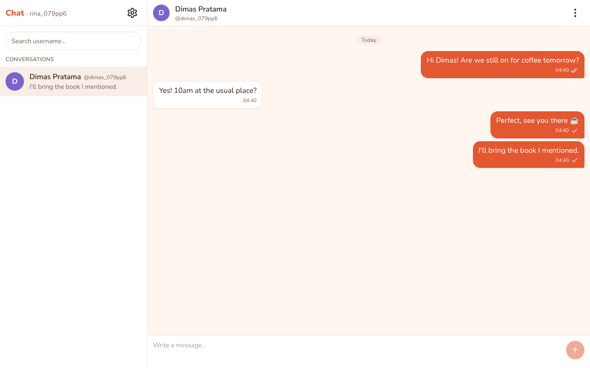
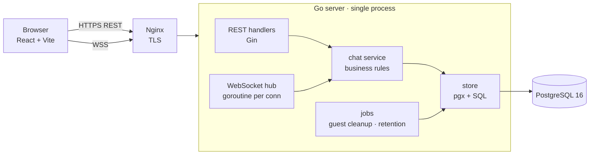
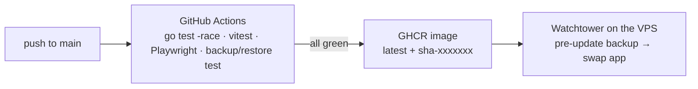

# pmess — Personal Messenger

[](https://github.com/tosrv/pmess/actions/workflows/ci.yml)
[](LICENSE)

**English** · [Bahasa Indonesia](README.id.md)

A real-time 1:1 chat app built as a learning project in **real-time systems and concurrency**: a Go backend with WebSockets and PostgreSQL, a React frontend, and a CI → registry → auto-deploy pipeline.

**Live demo:** <https://chat.rahmattomy.com> — sign in with Google, or continue as a guest to message the developer.



## Features

- Real-time 1:1 messaging over WebSocket, with **sent ✓ / read ✓✓** receipts and a typing indicator
- Find people by username; display names are separate from usernames
- **Guest mode**: chat with the developer without an account (deleted 30 minutes after the conversation's last activity)
- Block users, delete your own account, English/Indonesian UI, light/dark/system theme
- Messages survive offline periods and reconnects; conversations expire after 1 month without activity
- Abuse protection: Cloudflare Turnstile on guest sign-up, per-user and per-IP rate limits, a 300-account cap

## Architecture





All business rules live in one package (`internal/chat`), shared by REST and WebSocket, so a rule like "a guest may only message the developer" is written and tested once.

## How it handles concurrency

This is the part the project was built to learn. Each guarantee is enforced by the database or by a single code path, and each has a test you can run.

### 1. Gap-free, consistent ordering per conversation

Every message gets a sequence number from a counter on its conversation row. The `UPDATE … RETURNING` takes a row lock, so concurrent senders in the same conversation queue up instead of racing:

```sql
UPDATE conversations SET last_seq = last_seq + 1, last_activity_at = now()
WHERE id = $1 RETURNING last_seq
```

`TestConcurrentSend` has 50 users send at once — into 25 pair conversations and one shared conversation (1,000 messages from 50 senders) — and checks every conversation's sequence is exactly `1..N` with no gaps or duplicates. A global `BIGSERIAL` would have been simpler but can leave gaps and does not guarantee commit order matches id order under load.

### 2. No duplicates when a client resends

The browser generates a `client_msg_id` (UUID) and keeps unacknowledged messages in an outbox. After a reconnect it resends them with the same id. The database enforces `UNIQUE (sender_id, client_msg_id)`; a resend that hits it rolls back (so no sequence number is consumed) and returns the original message. `TestResend` fires the same message from two goroutines at once and expects one row.

### 3. Catching up after a disconnect

Clients remember the last `seq` they have for each conversation and ask `GET /api/conversations/:id/messages?after_seq=N` after reconnecting, paging until they are caught up. Combined with (2), "nothing lost, nothing doubled" holds across flaky networks.

### 4. The 300th account

The account cap is a one-row counter with a constraint, not a `COUNT(*)`:

```sql
used int NOT NULL CHECK (used BETWEEN 0 AND 300)
-- sign-up, inside the same transaction as the INSERT:
UPDATE user_slots SET used = used + 1 WHERE id = 1
```

Two people signing up for the last slot serialize on the row lock; the second one violates the `CHECK` and gets a clear "limit reached" error. `TestSlotRace` releases two goroutines at once and expects exactly one success.

### 5. Slow clients don't slow everyone else

Each WebSocket connection has a reader goroutine, a writer goroutine and a bounded outbound buffer (64 frames). Enqueueing never blocks: if a client can't keep up, its connection is closed and it catches up through (3) when it reconnects. Delivery to the recipient happens only after the message is committed.

## Load test

`cmd/loadtest` opens 50 WebSocket clients in 25 conversations, each sending 20 messages, and measures send-to-receive latency. Three consecutive runs on a single machine (server, Postgres and clients together):

| sent | received | missing | duplicates | p50 | p95 | max |
|---:|---:|---:|---:|---:|---:|---:|
| 1000 | 1000 | 0 | 0 | 25–28 ms | 40–46 ms | 56–74 ms |

The tool exits non-zero if any send fails, any message is missing or duplicated, or p95 reaches 1 s. How to run it: [docs/operations.md](docs/operations.md#verification).

## Tech stack

- **Backend:** Go 1.24, Gin, `coder/websocket`, pgx, golang-migrate, PostgreSQL 16
- **Frontend:** React 18, Vite, TypeScript, Tailwind CSS, shadcn/ui, react-i18next
- **Tests:** Go tests with `-race` against real Postgres (testcontainers), Vitest, Playwright
- **Ops:** Docker, GitHub Actions, GHCR, Watchtower, Nginx, Cloudflare Turnstile

## Run it

```bash
cp .env.example .env    # set POSTGRES_PASSWORD, DEVELOPER_EMAIL and Google OAuth keys; for localhost also set
                        # COOKIE_SECURE=false, OAUTH_REDIRECT_URL=http://localhost:8080/api/auth/google/callback,
                        # ALLOWED_ORIGINS=http://localhost:8080
docker compose -f docker-compose.yml -f docker-compose.dev.yml up --build -d
# then open http://localhost:8080
```

Verify the guarantees yourself (Docker must be running):

```bash
go test -race ./...
cd web && npm test
```

Local development, all environment variables, E2E tests, deployment, backups and restore are in the **[operations guide](docs/operations.md)**.

## Security & privacy

- Strict Content-Security-Policy and other security headers on every response
- Turnstile on guest sign-up, verified server-side before any rate-limit or account slot is used
- Blocking is invisible to the blocked person: they only ever see a generic "not found"
- Messages are **not** end-to-end encrypted — a server admin can read them in the database. This is stated in the app's [privacy policy](https://chat.rahmattomy.com/privacy).

## Design documents

The project was built spec-first. Designs and implementation plans for each phase are in [`docs/superpowers/`](docs/superpowers/) (written in Indonesian).

## License

[MIT](LICENSE)
